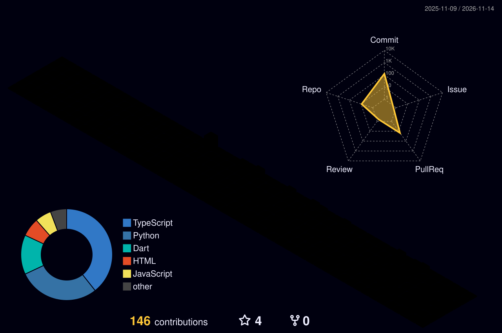

<!-- ==================== HERO BANNER ==================== -->
<div align="center">
  
</div>

<!-- ==================== DYNAMIC TAGLINE ==================== -->
<div align="center">
  
</div>

<br/>

<!-- ==================== ABOUT ME ==================== -->
## ⚡ About Me

```yaml
name: Bùi Minh Nhật (@MenBoyBMN)
role: Full-Stack & AI Engineer
location: Vietnam
focus:
  - AI Engineering: Agentic Workflows, RAG Pipelines & Local LLM Orchestration
  - Backend Systems: High-performance REST APIs with ASP.NET Core & FastAPI
  - Client Apps: Modern Web & Cross-Platform Mobile with React & Flutter
  - Automation & Infra: Workflow Orchestration (n8n), Docker & SQL Databases
contact: buiminhnhat2910@gmail.com
```

> Engineering production-ready software by combining **clean full-stack architecture** with **agentic AI workflows** — from autonomous LLM systems (`LangChain`, `LangGraph`, `Ollama`) to scalable APIs (`ASP.NET Core`, `FastAPI`) and responsive cross-platform interfaces (`React`, `Flutter`).

<br/>

<!-- ==================== TECH STACK ==================== -->
## 🛠️ Tech Stack & Capabilities

<div align="center">

### Languages
<p>
  
  
  
  
  
  
  
</p>

### Frameworks
<p>
  
  
  
  
</p>

### Tools & Infrastructure
<p>
  
  
  
  
  
</p>

### AI & Agentic Ecosystem
<p>
  
  
  
  
</p>

</div>

<br/>

<!-- ==================== FEATURED PROJECTS ==================== -->
## 🚀 Featured Projects

<div align="center">
  <a href="https://github.com/MenBoyBMN/SureBot">
    
  </a>
  &nbsp;
  <a href="https://github.com/MenBoyBMN/EduGuide_VN">
    
  </a>
  <br/><br/>
  <a href="https://github.com/MenBoyBMN/HairFit_AI">
    
  </a>
  &nbsp;
  <a href="https://github.com/MenBoyBMN/Lang_Blog_Podcast_Website_ASPdotNET">
    
  </a>
</div>

<br/>

<!-- ==================== GITHUB ANALYTICS ==================== -->
## 📊 GitHub Analytics

<div align="center">
  
  &nbsp;
  
</div>

<br/>

<div align="center">
  
</div>

<br/>

<div align="center">
  
</div>

<br/>

<!-- ==================== CONTRIBUTION GRAPHICS ==================== -->
## 🐍 Contribution Snake

<div align="center">
  <picture>
    <source media="(prefers-color-scheme: dark)" srcset="https://raw.githubusercontent.com/MenBoyBMN/MenBoyBMN/output/github-snake-dark.svg" />
    <source media="(prefers-color-scheme: light)" srcset="https://raw.githubusercontent.com/MenBoyBMN/MenBoyBMN/output/github-snake.svg" />
    
  </picture>
</div>

<br/>

## 🧊 3D Contribution Calendar

<div align="center">
  <picture>
    <source media="(prefers-color-scheme: dark)" srcset="https://raw.githubusercontent.com/MenBoyBMN/MenBoyBMN/main/profile-3d-contrib/profile-night-rainbow.svg" />
    <source media="(prefers-color-scheme: light)" srcset="https://raw.githubusercontent.com/MenBoyBMN/MenBoyBMN/main/profile-3d-contrib/profile-south-season-animate.svg" />
    
  </picture>
</div>

<br/>

<!-- ==================== CONNECT ==================== -->
## 🌐 Connect With Me

<div align="center">
  <a href="mailto:buiminhnhat2910@gmail.com">
    
  </a>
  &nbsp;
  <a href="https://www.facebook.com/minh.nhat.65912/">
    
  </a>
  &nbsp;
  <a href="https://github.com/MenBoyBMN">
    
  </a>
</div>

<br/>

<div align="center">
  
</div>

<br/>

<!-- ==================== FOOTER ==================== -->
<div align="center">
  
  &nbsp;
  <a href="https://github.com/MenBoyBMN?tab=followers">
    
  </a>
  &nbsp;
  <a href="https://github.com/MenBoyBMN?tab=repositories">
    
  </a>
</div>

<div align="center">
  
</div>
